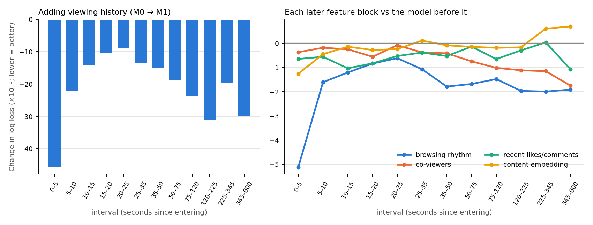

# KuaiLive Exit Risk

**Can we tell, while someone is watching a live stream, that they are about to leave?**

This repository builds a reproducible exit-prediction study on the public
[KuaiLive-M3](https://huggingface.co/datasets/imgkkk2004/KuaiLive-M3) viewing logs (Kuaishou, March 2026):

- **Labels.** It cleans raw viewing records into visits and voluntary-exit labels.
- **Model.** It trains LightGBM discrete-time survival models. For each of 12 intervals after a viewer
  enters a room, the model predicts the probability that the viewer leaves in that interval.
- **Ablation.** It measures what each kind of information adds, using nested models and shuffled-feature
  controls (placebos).
- **Data card.** It documents the dataset, which has no official field documentation:
  [`docs/data_card/data_card.pdf`](docs/data_card/data_card.pdf).

## Key findings

These results come from **our LightGBM models and features**. When a block shows little gain, these
models did not use it. That does not prove the information has no signal (see
[Open questions](#open-questions)).

- **What was tested:** each test row is one visit in one interval, with interval edges at
  `0, 5, 10, 15, 20, 25, 35, 50, 75, 120, 225, 345, 600` s.
- **Test sets:** users not seen in training, on the last five days of data. **C** has 1,000 users and 1.0M
  rows; **B** has 300 users and 0.25M rows.
- **Agreement:** the main effects hold on both B and C. Lower log loss is better.

| Model | Inputs | C log loss | C AUC | B log loss | B AUC |
|---|---|---:|---:|---:|---:|
| M0 | current visit state, entry context | 0.4515 | 0.773 | 0.4512 | 0.772 |
| M1 | + viewing history | 0.4272 | 0.805 | 0.4297 | 0.801 |
| M_all | + all blocks below | 0.4236 | 0.809 | 0.4266 | 0.804 |
| M_all (tuned) | same inputs, larger trees | **0.4231** | **0.810** | **0.4260** | **0.805** |

1. **Exit risk falls steeply with time watched.** In the first 5 s the per-second exit hazard is about
   11.6%. Between 345 and 600 s it is about 0.15%. About 44% of voluntary exits happen within 5 s.
2. **The first 5 seconds are the most predictable.** We compare only visits that reached the same interval.
   On that basis, AUC is 0.86 for 0–5 s and 0.66–0.73 for every later interval.
3. **Viewing history gives the largest gain.** It lowers log loss by 5.4% (C) and 4.8% (B), in every
   interval.
4. **All further blocks together add about 1%** (0.96% on C, 0.86% on B). Most of that gain is in the
   first 5 s.
5. **Different blocks help at different times.** The figure shows cohort C.

   

   - **Browsing rhythm** (how fast the user has been moving between rooms) helps most in the first 5 s.
   - **Co-viewers** (sampled viewers entering and leaving the room) give a small gain. On C it grows the
     longer the viewer stays.
   - **Recent likes and comments** in the room give a small, steady gain.
   - **Content embeddings** help a little, mostly in the first 5 s. They beat their shuffled placebo by
     about 0.0008 on both cohorts, but they slightly hurt the longest, sparsest intervals.
   - **Local time** and **past gifting/liking/commenting rates** show no gain: their placebos score the
     same as the real values.
6. **More data and larger trees give diminishing returns.** Going from 75 to 1,000 training users lowers
   log loss by 1.5–1.7%; going from 600 to 1,000 lowers it by only 0.2%. Larger trees lower it by
   another 0.13%.
7. **The labelling rule does not drive the results.** Broadcast-caused ends are 1.1–1.3% of visits. The
   positive rate changes by less than 0.05 percentage points across nine broadcast-end windows.

[`docs/results.md`](docs/results.md) has more detail:

- all models and placebos;
- per-interval tables;
- the learning curve;
- the label audit;
- a secondary 30-second-horizon summary with user-bootstrap intervals.

## Open questions

- **Model architecture.** Trees split on hand-built summaries and on one embedding dimension at a time.
  Two untested alternatives: sequence models over raw browsing and event streams, and learned
  user–content matching. Either may find signal these models miss.
- **Late intervals.** Content features overfit the long, sparse intervals. Pooling those intervals or
  adding regularization could help.
- **Unused data.** Comment text, impressions, questionnaires and the short-video domain are not used.
- **Capacity.** Several models stopped near the 3,000-round cap, and the learning curve is not flat. The
  tuned parameters were not re-searched for this feature set.
- **Separate effects.** The entry-state features sit inside M0, so their own contribution is not
  measured.
- **Robustness.** These results come from one training seed and one 28-day sample.

## Method

**Labels** (details in [`docs/sample_protocol.md`](docs/sample_protocol.md)):

- Records cut at local midnight are stitched back together.
- Same-room records separated by at most 1 s are merged into one visit.
- Prediction windows that touch a cross-room overlap are excluded.
- A visit that ends within `[T_b − 5 s, T_b + 60 s]` of the broadcast end `T_b` is censored, not counted
  as an exit.

Features use only information from before each interval starts.

**Cohorts.** Users are split by SHA-256 of their ID into three disjoint groups:

- **A** (1,000 users) trains on the first 18 days and early-stops on the next 5.
- **B** (300 users) and **C** (1,000 users) are test sets on the last 5 days.

No B or C visit or label is used for training, early stopping or tuning. Before C is scored, the code,
inputs and model files are frozen by hash.

**Models.** They are nested: each one adds a block to the one before.

| Block | Contents | Code name in results |
|---|---|---|
| M0: state | seconds watched, broadcast age, auto-play, follows streamer, entry action and source page | `M0` |
| + history | recent visit lengths and counts, share of quick exits, time since last visit, history with this streamer | `M1` |
| + browsing rhythm | visits started/ended in the last 1/5/15 min, last three visit lengths, fast-swipe streak | `M1_browse_personal` |
| + local time | hour of day, weekday | `M1_browse_time` |
| + co-viewers | sampled users in the room, their entries/exits in the last 60 s | `M1_browse_room` |
| + past action rates | share of past visits with gifts, likes, comments | `M1_browse_actions` |
| + recent likes/comments | like/comment counts in the room, last 1/5/15 min | `M1_events` |
| + content | latest 128-d segment embedding of the stream and its age | `M_all` |

- **Fixed models** use `num_leaves=31, learning_rate=0.05, min_child_samples=100`.
- **The tuned model** uses `num_leaves=127, learning_rate=0.03, min_child_samples=300`, taken from an
  earlier search on A's validation days.
- **Training:** all models train for up to 3,000 rounds with early stopping.
- **Code-name suffixes:** `_fixed` marks the default parameters and `_placebo` the shuffled control.
- **Column definitions:** [`configs/features.yaml`](configs/features.yaml) and the data card.

## Reproducing

```bash
python3.13 -m venv .venv && source .venv/bin/activate
python -m pip install -r requirements.lock
python -m pip install --no-deps --no-build-isolation -e .
make test
make download                          # ~40 GB raw data, SHA-256 checked
make smoke                             # 20-user end-to-end check, minutes
export KUAILIVE_RUN_ID=my-run          # any new name; finished runs are never overwritten
make features                          # ~1.3 h
make formal                            # train, test on B, freeze, test on C; ~3 h, ~8 GB RAM
make learning-curve && make audit && make report   # report rewrites docs/results.md
```

The timings above were measured on an Apple-silicon Mac. The reported run is `formal-v1.1.0`; its
metrics, hashes and manifests are in [`results/formal-v1.1.0/`](results/formal-v1.1.0/). More detail is
in [`docs/reproduce.md`](docs/reproduce.md).

```text
configs/   settings          src/kuailive_exit/   pipeline code      scripts/   entry points
tests/     regression tests  results/             reported metrics   docs/      data card, protocol, results
```

## Data, license, limitations

- **Data.** KuaiLive-M3 revision `417923d442a793b3e92cc7e079dd4b73fe706c30`. No raw or row-level data is
  included here. The dataset page lists CC BY-SA 4.0, while the paper states CC BY-NC-SA 4.0; treat it
  as non-commercial research data.
- **Code.** MIT License.
- **Limitations.** Users are a sample of active users, so co-viewer counts only cover sampled users. We
  assume each embedding segment is available at its timestamp. Visit reconstruction and censoring are
  modelling assumptions. An exit is a logged event, not a measure of dissatisfaction.
- **Earlier work.** Notes on our earlier exploratory versions are in
  [`docs/development_log.md`](docs/development_log.md).
- **Citation.** If you use the data, cite the KuaiLive-M3 paper: <https://arxiv.org/abs/2607.24862>.
