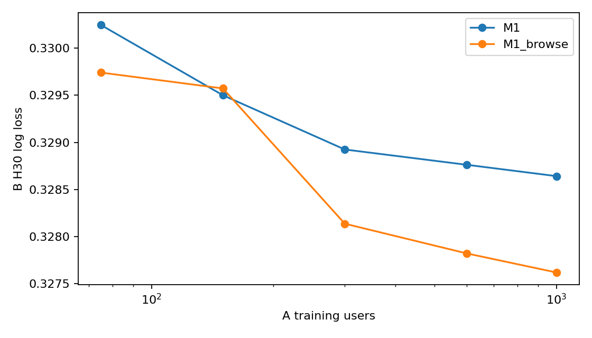

# Results

Run `formal-v1.1.0`. All tables are generated from the aggregate metric files under `results/formal-v1.1.0/` by `scripts/write_result_tables.py`.

The models are discrete-time survival models: each test row is one visit in one of the non-uniform intervals `[0, 5, 10, 15, 20, 25, 35, 50, 75, 120, 225, 345, 600]` (seconds), and the model predicts the probability that the user leaves within that interval. The interval metrics below evaluate exactly this output.

Cohorts: A trains (first 18 days) and early-stops (next 5 days); B (300 users) and C (1,000 users) are test cohorts disjoint from A on the last 5 days. Model fitting and early stopping use only supervised rows and labels from A; the tuned parameters come from an earlier search on A validation. B and C contribute no supervised training rows or labels. Room-context features aggregate already observed logs from all released sampled users, including users in B and C, without using their future labels. C was also evaluated as a test cohort in earlier model experiments. The code, inputs and model files are hash-frozen before the single C evaluation within this run.

## C: interval predictions

All interval rows of the test period, weighted by row. Lower log loss and Brier are better.

| model | n | positive_rate | log_loss | brier | auc | ap |
| --- | --- | --- | --- | --- | --- | --- |
| M0_fixed | 1002460 | 0.242167 | 0.451456 | 0.143621 | 0.773007 | 0.560419 |
| M1_fixed | 1002460 | 0.242167 | 0.427145 | 0.135714 | 0.805457 | 0.623019 |
| M1_browse_personal_fixed | 1002460 | 0.242167 | 0.424823 | 0.134917 | 0.807756 | 0.627730 |
| M1_browse_time_fixed | 1002460 | 0.242167 | 0.424889 | 0.134934 | 0.807734 | 0.627603 |
| M1_browse_room_fixed | 1002460 | 0.242167 | 0.424454 | 0.134788 | 0.808316 | 0.628403 |
| M1_browse_actions_fixed | 1002460 | 0.242167 | 0.424672 | 0.134857 | 0.807972 | 0.627954 |
| M1_events_fixed | 1002460 | 0.242167 | 0.424062 | 0.134690 | 0.808764 | 0.628884 |
| M_all_fixed | 1002460 | 0.242167 | 0.423612 | 0.134523 | 0.809245 | 0.630439 |
| M_all_tuned | 1002460 | 0.242167 | 0.423067 | 0.134327 | 0.809774 | 0.631591 |
| M1_browse_personal_placebo | 1002460 | 0.242167 | 0.427064 | 0.135688 | 0.805482 | 0.623263 |
| M1_browse_time_placebo | 1002460 | 0.242167 | 0.424836 | 0.134927 | 0.807731 | 0.627779 |
| M1_browse_room_placebo | 1002460 | 0.242167 | 0.424699 | 0.134867 | 0.807858 | 0.628045 |
| M1_browse_actions_placebo | 1002460 | 0.242167 | 0.424519 | 0.134821 | 0.808244 | 0.628167 |
| M1_events_placebo | 1002460 | 0.242167 | 0.424488 | 0.134789 | 0.808161 | 0.628497 |
| M_all_placebo | 1002460 | 0.242167 | 0.424429 | 0.134784 | 0.808440 | 0.628623 |

### C: by interval

AUC within an interval compares visits that reached the same elapsed time.

| interval | n | exit_rate | M0_fixed_log_loss | M0_fixed_auc | M1_fixed_log_loss | M1_fixed_auc | M_all_fixed_log_loss | M_all_fixed_auc | M_all_tuned_log_loss | M_all_tuned_auc |
| --- | --- | --- | --- | --- | --- | --- | --- | --- | --- | --- |
| 0–5 s | 262634 | 0.441390 | 0.514264 | 0.805741 | 0.468649 | 0.852913 | 0.461975 | 0.857890 | 0.460380 | 0.858978 |
| 5–10 s | 145860 | 0.236281 | 0.511703 | 0.673084 | 0.489658 | 0.722288 | 0.487100 | 0.727118 | 0.486601 | 0.728099 |
| 10–15 s | 110677 | 0.146363 | 0.402828 | 0.631677 | 0.388741 | 0.688107 | 0.386515 | 0.694467 | 0.386474 | 0.695116 |
| 15–20 s | 93945 | 0.106839 | 0.330753 | 0.618397 | 0.320361 | 0.678644 | 0.317884 | 0.689509 | 0.317996 | 0.689760 |
| 20–25 s | 83462 | 0.085045 | 0.284470 | 0.606517 | 0.275647 | 0.674472 | 0.274234 | 0.682940 | 0.274073 | 0.684105 |
| 25–35 s | 75686 | 0.130368 | 0.377994 | 0.606187 | 0.364386 | 0.677925 | 0.362561 | 0.686078 | 0.362613 | 0.686562 |
| 35–50 s | 64953 | 0.162364 | 0.424259 | 0.622359 | 0.409409 | 0.689156 | 0.406551 | 0.698866 | 0.406100 | 0.699961 |
| 50–75 s | 53462 | 0.187797 | 0.472054 | 0.598517 | 0.453163 | 0.676221 | 0.450544 | 0.684226 | 0.450470 | 0.684886 |
| 75–120 s | 42386 | 0.220545 | 0.517631 | 0.591966 | 0.493871 | 0.674025 | 0.490799 | 0.682671 | 0.491539 | 0.681769 |
| 120–225 s | 31792 | 0.292149 | 0.593781 | 0.587575 | 0.562667 | 0.676953 | 0.558731 | 0.685456 | 0.558511 | 0.686025 |
| 225–345 s | 21700 | 0.225115 | 0.526010 | 0.581421 | 0.506412 | 0.658233 | 0.504041 | 0.664744 | 0.503496 | 0.665905 |
| 345–600 s | 15903 | 0.318619 | 0.618309 | 0.578760 | 0.588278 | 0.663786 | 0.585253 | 0.669250 | 0.583341 | 0.672595 |

## B: interval predictions

All interval rows of the test period, weighted by row. Lower log loss and Brier are better.

| model | n | positive_rate | log_loss | brier | auc | ap |
| --- | --- | --- | --- | --- | --- | --- |
| M0_fixed | 246728 | 0.242352 | 0.451178 | 0.143380 | 0.771730 | 0.566440 |
| M1_fixed | 246728 | 0.242352 | 0.429675 | 0.136285 | 0.800790 | 0.622965 |
| M1_browse_personal_fixed | 246728 | 0.242352 | 0.428173 | 0.135780 | 0.802362 | 0.625750 |
| M1_browse_time_fixed | 246728 | 0.242352 | 0.428118 | 0.135790 | 0.802447 | 0.625693 |
| M1_browse_room_fixed | 246728 | 0.242352 | 0.427445 | 0.135563 | 0.803438 | 0.626696 |
| M1_browse_actions_fixed | 246728 | 0.242352 | 0.427506 | 0.135653 | 0.803261 | 0.626208 |
| M1_events_fixed | 246728 | 0.242352 | 0.426802 | 0.135435 | 0.804384 | 0.627160 |
| M_all_fixed | 246728 | 0.242352 | 0.426570 | 0.135397 | 0.804457 | 0.627674 |
| M_all_tuned | 246728 | 0.242352 | 0.425998 | 0.135206 | 0.804996 | 0.628996 |
| M1_browse_personal_placebo | 246728 | 0.242352 | 0.429716 | 0.136335 | 0.800817 | 0.622731 |
| M1_browse_time_placebo | 246728 | 0.242352 | 0.428149 | 0.135774 | 0.802440 | 0.625832 |
| M1_browse_room_placebo | 246728 | 0.242352 | 0.428086 | 0.135781 | 0.802547 | 0.625682 |
| M1_browse_actions_placebo | 246728 | 0.242352 | 0.427535 | 0.135600 | 0.803395 | 0.626631 |
| M1_events_placebo | 246728 | 0.242352 | 0.427522 | 0.135665 | 0.803430 | 0.626106 |
| M_all_placebo | 246728 | 0.242352 | 0.427427 | 0.135670 | 0.803734 | 0.626046 |

### B: by interval

AUC within an interval compares visits that reached the same elapsed time.

| interval | n | exit_rate | M0_fixed_log_loss | M0_fixed_auc | M1_fixed_log_loss | M1_fixed_auc | M_all_fixed_log_loss | M_all_fixed_auc | M_all_tuned_log_loss | M_all_tuned_auc |
| --- | --- | --- | --- | --- | --- | --- | --- | --- | --- | --- |
| 0–5 s | 64124 | 0.437496 | 0.501755 | 0.817556 | 0.461533 | 0.858205 | 0.455950 | 0.861910 | 0.454318 | 0.863027 |
| 5–10 s | 35907 | 0.236556 | 0.510186 | 0.678609 | 0.494135 | 0.714914 | 0.491714 | 0.719263 | 0.491897 | 0.719251 |
| 10–15 s | 27285 | 0.147517 | 0.405220 | 0.624416 | 0.393034 | 0.678004 | 0.391333 | 0.683127 | 0.391140 | 0.684372 |
| 15–20 s | 23155 | 0.107363 | 0.333234 | 0.606801 | 0.324886 | 0.662363 | 0.322956 | 0.673109 | 0.322749 | 0.675180 |
| 20–25 s | 20606 | 0.088955 | 0.294318 | 0.598743 | 0.285882 | 0.666015 | 0.284198 | 0.675596 | 0.284101 | 0.676727 |
| 25–35 s | 18646 | 0.130323 | 0.379446 | 0.600527 | 0.368261 | 0.663872 | 0.365679 | 0.674055 | 0.365347 | 0.676751 |
| 35–50 s | 16058 | 0.159360 | 0.427192 | 0.600686 | 0.410173 | 0.679480 | 0.407907 | 0.684723 | 0.407507 | 0.686641 |
| 50–75 s | 13312 | 0.186599 | 0.471598 | 0.592964 | 0.452612 | 0.674450 | 0.450270 | 0.681482 | 0.449807 | 0.682745 |
| 75–120 s | 10601 | 0.228092 | 0.530352 | 0.574948 | 0.508918 | 0.662879 | 0.507540 | 0.667644 | 0.507551 | 0.667265 |
| 120–225 s | 7909 | 0.313567 | 0.618495 | 0.565050 | 0.586022 | 0.659596 | 0.581409 | 0.668301 | 0.581164 | 0.669157 |
| 225–345 s | 5280 | 0.232576 | 0.535163 | 0.581434 | 0.511960 | 0.666837 | 0.507768 | 0.677117 | 0.507227 | 0.680302 |
| 345–600 s | 3845 | 0.339142 | 0.633192 | 0.579165 | 0.604863 | 0.654712 | 0.603183 | 0.658588 | 0.601248 | 0.664427 |

## Derived 30-second horizon (H30)

For comparison with fixed-horizon formulations, interval hazards are also converted to the probability of leaving in the next 30 s at checkpoints t = 30, 60, …, 570 s, assuming a constant hazard inside each interval (a 30 s window inside a 255 s interval receives 30/255 of that interval's cumulative hazard). Elapsed time, broadcast age and clock fields move with the window; other features stay at their value at t. The labels are observed exits in (t, t + 30 s]: an exit exactly at t + 30 s is included; a visit ending at t is not at risk. This is a secondary, approximate summary; it does not cover the first 30 s of a visit.

### C: H30

| model | n | positive_rate | log_loss | brier | auc | ap |
| --- | --- | --- | --- | --- | --- | --- |
| M0_fixed | 449700 | 0.119188 | 0.327980 | 0.095734 | 0.727182 | 0.289779 |
| M1_fixed | 449700 | 0.119188 | 0.316145 | 0.092836 | 0.759987 | 0.327894 |
| M1_browse_personal_fixed | 449700 | 0.119188 | 0.315170 | 0.092580 | 0.762420 | 0.331736 |
| M1_browse_time_fixed | 449700 | 0.119188 | 0.315126 | 0.092574 | 0.762554 | 0.332004 |
| M1_browse_room_fixed | 449700 | 0.119188 | 0.314478 | 0.092417 | 0.764018 | 0.333389 |
| M1_browse_actions_fixed | 449700 | 0.119188 | 0.314632 | 0.092442 | 0.763746 | 0.333863 |
| M1_events_fixed | 449700 | 0.119188 | 0.314331 | 0.092350 | 0.764211 | 0.335054 |
| M_all_fixed | 449700 | 0.119188 | 0.314210 | 0.092304 | 0.764375 | 0.335366 |
| M_all_tuned | 449700 | 0.119188 | 0.314046 | 0.092288 | 0.764944 | 0.336347 |
| M1_browse_personal_placebo | 449700 | 0.119188 | 0.315918 | 0.092783 | 0.760524 | 0.328232 |
| M1_browse_time_placebo | 449700 | 0.119188 | 0.315088 | 0.092569 | 0.762632 | 0.331713 |
| M1_browse_room_placebo | 449700 | 0.119188 | 0.314905 | 0.092516 | 0.762854 | 0.332542 |
| M1_browse_actions_placebo | 449700 | 0.119188 | 0.314534 | 0.092425 | 0.763862 | 0.333443 |
| M1_events_placebo | 449700 | 0.119188 | 0.314480 | 0.092401 | 0.763908 | 0.334160 |
| M_all_placebo | 449700 | 0.119188 | 0.314286 | 0.092354 | 0.764174 | 0.334312 |

### C: H30 paired user bootstrap

Difference = candidate minus baseline (negative = better), 2,000 user resamples, seed 20261001. Intervals condition on the fitted models and exclude training randomness and dependence between users sharing rooms; no multiplicity adjustment.

| model | baseline | users | rows | difference | ci95_lower | ci95_upper |
| --- | --- | --- | --- | --- | --- | --- |
| M0_fixed | M1_fixed | 981 | 449700 | 0.011835 | 0.010535 | 0.013130 |
| M1_browse_actions_fixed | M1_fixed | 981 | 449700 | -0.001513 | -0.001890 | -0.001149 |
| M1_browse_actions_placebo | M1_fixed | 981 | 449700 | -0.001611 | -0.001937 | -0.001287 |
| M1_browse_personal_fixed | M1_fixed | 981 | 449700 | -0.000975 | -0.001206 | -0.000752 |
| M1_browse_personal_placebo | M1_fixed | 981 | 449700 | -0.000227 | -0.000346 | -0.000111 |
| M1_browse_room_fixed | M1_fixed | 981 | 449700 | -0.001667 | -0.001994 | -0.001349 |
| M1_browse_room_placebo | M1_fixed | 981 | 449700 | -0.001240 | -0.001528 | -0.000982 |
| M1_browse_time_fixed | M1_fixed | 981 | 449700 | -0.001019 | -0.001279 | -0.000780 |
| M1_browse_time_placebo | M1_fixed | 981 | 449700 | -0.001057 | -0.001303 | -0.000822 |
| M1_events_fixed | M1_fixed | 981 | 449700 | -0.001814 | -0.002189 | -0.001450 |
| M1_events_placebo | M1_fixed | 981 | 449700 | -0.001665 | -0.002034 | -0.001298 |
| M1_fixed | M1_fixed | 981 | 449700 | 0.000000 | 0.000000 | 0.000000 |
| M_all_fixed | M1_fixed | 981 | 449700 | -0.001935 | -0.002351 | -0.001522 |
| M_all_placebo | M1_fixed | 981 | 449700 | -0.001859 | -0.002245 | -0.001485 |
| M_all_tuned | M1_fixed | 981 | 449700 | -0.002099 | -0.002518 | -0.001704 |
| M1_fixed | M0_fixed | 981 | 449700 | -0.011835 | -0.013130 | -0.010535 |
| M1_browse_personal_fixed | M1_fixed | 981 | 449700 | -0.000975 | -0.001206 | -0.000752 |
| M1_browse_time_fixed | M1_browse_personal_fixed | 981 | 449700 | -0.000044 | -0.000173 | 0.000093 |
| M1_browse_room_fixed | M1_browse_time_fixed | 981 | 449700 | -0.000648 | -0.000867 | -0.000434 |
| M1_browse_actions_fixed | M1_browse_room_fixed | 981 | 449700 | 0.000153 | -0.000033 | 0.000340 |
| M1_events_fixed | M1_browse_actions_fixed | 981 | 449700 | -0.000300 | -0.000485 | -0.000112 |
| M_all_fixed | M1_events_fixed | 981 | 449700 | -0.000121 | -0.000399 | 0.000161 |
| M_all_tuned | M_all_fixed | 981 | 449700 | -0.000164 | -0.000330 | -0.000002 |

### B: H30

| model | n | positive_rate | log_loss | brier | auc | ap |
| --- | --- | --- | --- | --- | --- | --- |
| M0_fixed | 109833 | 0.123952 | 0.340724 | 0.100164 | 0.716054 | 0.277455 |
| M1_fixed | 109833 | 0.123952 | 0.328641 | 0.097011 | 0.748979 | 0.318983 |
| M1_browse_personal_fixed | 109833 | 0.123952 | 0.327882 | 0.096846 | 0.750963 | 0.321024 |
| M1_browse_time_fixed | 109833 | 0.123952 | 0.327643 | 0.096801 | 0.751484 | 0.321167 |
| M1_browse_room_fixed | 109833 | 0.123952 | 0.327278 | 0.096709 | 0.752457 | 0.322175 |
| M1_browse_actions_fixed | 109833 | 0.123952 | 0.327618 | 0.096823 | 0.752072 | 0.320369 |
| M1_events_fixed | 109833 | 0.123952 | 0.326804 | 0.096587 | 0.753770 | 0.323330 |
| M_all_fixed | 109833 | 0.123952 | 0.326836 | 0.096656 | 0.753977 | 0.322562 |
| M_all_tuned | 109833 | 0.123952 | 0.326474 | 0.096563 | 0.755039 | 0.324526 |
| M1_browse_personal_placebo | 109833 | 0.123952 | 0.328516 | 0.096994 | 0.749143 | 0.319523 |
| M1_browse_time_placebo | 109833 | 0.123952 | 0.327711 | 0.096812 | 0.751347 | 0.321452 |
| M1_browse_room_placebo | 109833 | 0.123952 | 0.327675 | 0.096792 | 0.751259 | 0.321600 |
| M1_browse_actions_placebo | 109833 | 0.123952 | 0.327346 | 0.096727 | 0.752268 | 0.322083 |
| M1_events_placebo | 109833 | 0.123952 | 0.327553 | 0.096838 | 0.752193 | 0.320094 |
| M_all_placebo | 109833 | 0.123952 | 0.326909 | 0.096684 | 0.753804 | 0.321406 |

### B: H30 paired user bootstrap

Difference = candidate minus baseline (negative = better), 2,000 user resamples, seed 20261001. Intervals condition on the fitted models and exclude training randomness and dependence between users sharing rooms; no multiplicity adjustment.

| model | baseline | users | rows | difference | ci95_lower | ci95_upper |
| --- | --- | --- | --- | --- | --- | --- |
| M0_fixed | M1_fixed | 286 | 109833 | 0.012082 | 0.009825 | 0.014435 |
| M1_browse_actions_fixed | M1_fixed | 286 | 109833 | -0.001023 | -0.001617 | -0.000437 |
| M1_browse_actions_placebo | M1_fixed | 286 | 109833 | -0.001295 | -0.001860 | -0.000827 |
| M1_browse_personal_fixed | M1_fixed | 286 | 109833 | -0.000759 | -0.001191 | -0.000365 |
| M1_browse_personal_placebo | M1_fixed | 286 | 109833 | -0.000126 | -0.000382 | 0.000143 |
| M1_browse_room_fixed | M1_fixed | 286 | 109833 | -0.001363 | -0.001880 | -0.000893 |
| M1_browse_room_placebo | M1_fixed | 286 | 109833 | -0.000966 | -0.001386 | -0.000591 |
| M1_browse_time_fixed | M1_fixed | 286 | 109833 | -0.000999 | -0.001453 | -0.000582 |
| M1_browse_time_placebo | M1_fixed | 286 | 109833 | -0.000930 | -0.001340 | -0.000539 |
| M1_events_fixed | M1_fixed | 286 | 109833 | -0.001837 | -0.002604 | -0.001168 |
| M1_events_placebo | M1_fixed | 286 | 109833 | -0.001088 | -0.001658 | -0.000494 |
| M1_fixed | M1_fixed | 286 | 109833 | 0.000000 | 0.000000 | 0.000000 |
| M_all_fixed | M1_fixed | 286 | 109833 | -0.001806 | -0.002639 | -0.000969 |
| M_all_placebo | M1_fixed | 286 | 109833 | -0.001732 | -0.002527 | -0.001037 |
| M_all_tuned | M1_fixed | 286 | 109833 | -0.002167 | -0.003146 | -0.001202 |
| M1_fixed | M0_fixed | 286 | 109833 | -0.012082 | -0.014435 | -0.009825 |
| M1_browse_personal_fixed | M1_fixed | 286 | 109833 | -0.000759 | -0.001191 | -0.000365 |
| M1_browse_time_fixed | M1_browse_personal_fixed | 286 | 109833 | -0.000239 | -0.000518 | 0.000008 |
| M1_browse_room_fixed | M1_browse_time_fixed | 286 | 109833 | -0.000365 | -0.000750 | 0.000029 |
| M1_browse_actions_fixed | M1_browse_room_fixed | 286 | 109833 | 0.000340 | -0.000001 | 0.000741 |
| M1_events_fixed | M1_browse_actions_fixed | 286 | 109833 | -0.000814 | -0.001456 | -0.000293 |
| M_all_fixed | M1_events_fixed | 286 | 109833 | 0.000032 | -0.000611 | 0.000704 |
| M_all_tuned | M_all_fixed | 286 | 109833 | -0.000362 | -0.000696 | -0.000026 |

## Training and learning curve

M_all_tuned uses parameters from an earlier search on the validation days of cohort A; they were not re-searched in this run. Best iteration per model (cap 3,000):

| model | best_iteration |
| --- | --- |
| M0_fixed | 651 |
| M1_fixed | 2137 |
| M1_browse_personal_fixed | 3000 |
| M1_browse_time_fixed | 2757 |
| M1_browse_room_fixed | 2251 |
| M1_browse_actions_fixed | 2999 |
| M1_events_fixed | 2780 |
| M_all_fixed | 2996 |
| M_all_tuned | 1996 |
| M1_browse_personal_placebo | 2543 |
| M1_browse_time_placebo | 2816 |
| M1_browse_room_placebo | 2173 |
| M1_browse_actions_placebo | 2940 |
| M1_events_placebo | 2260 |
| M_all_placebo | 1826 |

Learning curve on B (models trained on nested subsets of A):

| model | training_users | n | log_loss | auc | best_iteration |
| --- | --- | --- | --- | --- | --- |
| M1_n75 | 75 | 246728 | 0.436125 | 0.794325 | 219 |
| M1_browse_n75 | 75 | 246728 | 0.435019 | 0.795916 | 247 |
| M1_n150 | 150 | 246728 | 0.433485 | 0.796900 | 367 |
| M1_browse_n150 | 150 | 246728 | 0.432214 | 0.797863 | 705 |
| M1_n300 | 300 | 246728 | 0.431652 | 0.798478 | 718 |
| M1_browse_n300 | 300 | 246728 | 0.430013 | 0.800594 | 785 |
| M1_n600 | 600 | 246728 | 0.430460 | 0.799819 | 1139 |
| M1_browse_n600 | 600 | 246728 | 0.428515 | 0.802262 | 1497 |
| M1_n1000 | 1000 | 246728 | 0.429675 | 0.800790 | 2137 |
| M1_browse_n1000 | 1000 | 246728 | 0.427506 | 0.803261 | 2999 |

## Label audit

A/train visits: 931,824; end classification: `{'user': 915911, 'broadcast': 10765, 'entered_after_end': 4187, 'record_anomaly': 941, 'observation_censored': 20}`. The delay histogram and the nine broadcast-end window settings are in `results/formal-v1.1.0/exp_protocol_audit/`.

Test-period duration summaries (quality-passing visits classified as user exits):

| cohort | valid_user_exit_visits | exit_within_5s_fraction | exit_within_30s_fraction | exit_within_35s_fraction |
| --- | --- | --- | --- | --- |
| A | 254650 | 0.426051 | 0.721869 | 0.740483 |
| B | 64208 | 0.439587 | 0.728523 | 0.747041 |
| C | 263971 | 0.442980 | 0.730834 | 0.748537 |

## Scope

- Results describe these LightGBM models and features; small increments do not show that a kind of information carries no signal.
- One trained seed, shared-room dependence and iteration caps limit inference. Repeated seeds, room/time resampling and data from another period would strengthen the conclusions.
- Raw inputs, processed rows, model files and predictions are not distributed. Download the pinned raw inputs and run the commands in `reproduce.md`.
